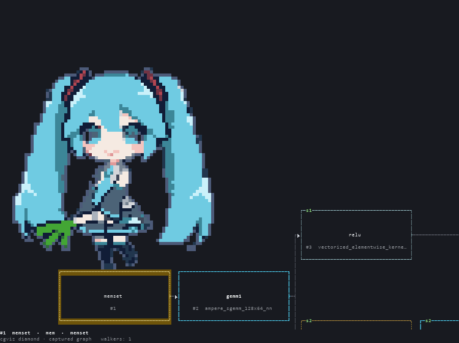
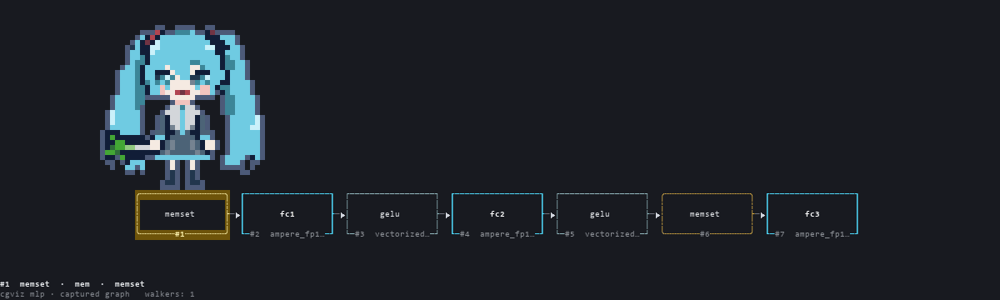
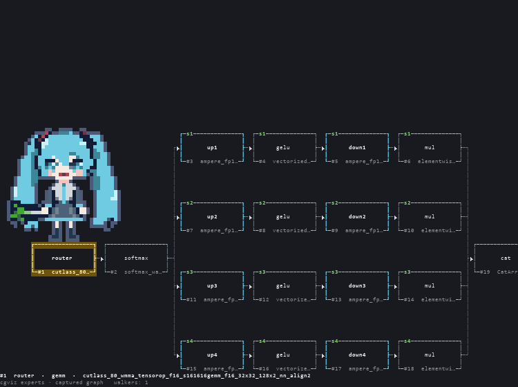
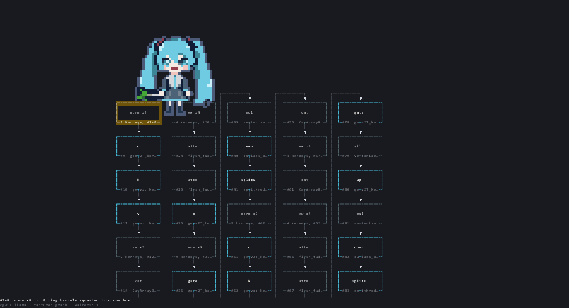

# cuda-literal-graphs

so cuda graphs arent graphs and i had some time in my university so i was like hey what if you could like more deterministically map out and see execution of every fucking work or kernel youre running and thats pretty doable so i built that , cuda graphs that are like literally graphs 

ai generated readmes for pet projects are disgusting i thought itd be fine for this one guh it did NOT sound like me, but anyway heres what i fucked around with



`cgviz` captures a real PyTorch workload as a CUDA graph, draws that graph in your terminal with the actual kernel names on the boxes, and then Hatsune Miku walks it. She waits at joins. She splits up at forks. She does a little hop at the end.


so every box is a kernel that cublas or pytorch really launches on a 3050 in the order the gpu ran them


## Three graphs, three lessons

singular streams get like one line 
**One stream is a straight line.** This is a 3-layer MLP, so each kernel waits for every next one and its just a simple representation so if you try to do something actually complex its probably gonna suck 




this one was more fun, so streams obviously make forks, you get four "experts" on four streams and the graphs fork four ways then rejoin 



**A real model is a long, long line.** Two layers of a TinyLlama-sized decoder, decoding one token: RoPE, a KV cache, FlashAttention, SwiGLU. It's 84 kernels, mostly tiny elementwise ones, so runs of them get folded into one box (`norm x9`). The graph is far too tall for a terminal, so it's wrapped into columns, like a newspaper.



## What the walk means (and what it doesn't)

| You see | It means |
|---|---|
| a box lights up when she reaches it | that kernel's turn: everything it depends on is finished |
| she splits into several Mikus, who leave together | a fork: kernels that only depend on this one, all ready at once |
| a Miku stops and waits for the others | a join: this kernel waits for every branch |
| one Miku, one straight line | a single stream: each kernel waits for the last |
| which Miku gets there first | **nothing.** The graph stores dependencies, not durations |

She walks at the same speed everywhere. There is no time axis. A fork means "these don't wait for each other", which is what lets the GPU overlap them; it doesn't promise they ran at the same time.

A few other honest notes:

- These are eager-mode kernels, one per op. An RMSNorm written in plain PyTorch is about 8 kernels, which is why the folded boxes exist. The list under the drawing names every one.
- cuBLAS only picks the matmul kernels (GEMM, GEMV or split-K, depending on the shape and your GPU). Softmax, concat and the elementwise stuff are PyTorch's own.
- Every run starts with a header: how many streams were seen during capture, the GPU, the CUDA and cuBLAS versions, and the main GEMM shapes. So you know where the picture came from.

## Try it without a GPU

The repo ships with saved captures, so you can watch her walk on any machine, Windows included. From a checkout, in PowerShell:

```powershell
cd "D:\path\to\cuda-literal-graphs"
```

```powershell
pip install networkx numpy matplotlib
```

```powershell
python -m cgviz show tests\fixtures\graphs\llama.json --labels llama
```

Swap `llama` for `diamond`, `decode`, `mlp` or `experts` (both the file name and the `--labels`). Make the terminal big; full-screen Windows Terminal is good. `Ctrl+C` stops her.

## Capture your own

This part needs an NVIDIA GPU on Linux or WSL2, Python 3.10, and torch 2.14.1 built for CUDA 13.0 (older torch can't list the nodes of a captured graph, and cgviz will tell you so). You also want `c++filt` from binutils, for readable kernel names.

```bash
pip install -r requirements.txt && pip install -e .
```

Then:

| Command | What gets captured |
|---|---|
| `cgviz diamond` | two branches on two streams, joined |
| `cgviz decode` | one transformer layer, 1 token |
| `cgviz prefill` | the same layer, 512 tokens |
| `cgviz draw examples/mlp.py:make` | the MLP above |
| `cgviz draw examples/experts.py:make` | the four experts above |
| `cgviz draw examples/llama_decode.py:make` | the two Llama layers above |
| `cgviz draw my_model.py:make` | yours |
| `cgviz show out/.../graph_data.json` | replay a capture you saved earlier |
| `cgviz env` | print the versions it would put in the header |

For your own model, `make()` returns `(step, inputs)` and `step(*inputs)` is what gets captured. An optional `ROLES` list in the same file names the matmuls in order (Q, K, V, ...). The files in `examples/` show the pattern, including `cgviz.presets.fork` for putting work on separate streams. Anything that reads back to the CPU inside `step` (`.item()`, `.cpu()`, `print(tensor)`) breaks capture.

Options worth knowing:

| Option | What it does |
|---|---|
| `--miku-size compact` | the default Miku, about two boxes wide |
| `--miku-size full` | the big one. The boxes grow to match her, so give her a big terminal |
| `--view follow` | spread the map out and follow her with the camera instead of showing everything |
| `--speed 2` | she walks faster |
| `--no-miku` | just the drawing, no Miku |
| `--full-names` | don't shorten the kernel names in the list |
| `--out DIR` | where captures go (default `out/`) |

Each capture lands in `out/<command>-<timestamp>/`: `graph_data.json` (what `show` reads), `provenance.json` (the header), `graph.dot` (NVIDIA's own dump, with launch configs) and `graph.txt` (the drawing as plain text).

## Small print

- Tested on one GPU, an RTX 3050 Laptop. Your GPU and library versions will pick different kernels, im broke man dont have high hopes from me
- It's built for small graphs. A couple of decoder layers is about the limit before it becomes wallpaper of random gibberish.
- The runtime is standard library only. The GIFs here were rendered with `tools/snap.py`, which needs Pillow.

## License and credits

The code is MIT; see [LICENSE](LICENSE).

**Hatsune Miku © Crypton Future Media, INC. www.piapro.net**

The Miku sprite art (`cgviz/assets/miku/`, the drawings under `findings/` and `assets/`, and the GIFs in `media/`) is fan art of a character owned by Crypton Future Media. It is **not** under the MIT license. It's shared for non-commercial use under the [Piapro Character License](https://piapro.net/intl/en_for_creators.html), so please don't use it commercially. If you need something you can use commercially, `--no-miku` draws the graph on its own.
