# Miku v2: GATE 2 package

GATE 1 was approved on two conditions. Both are done, then the GATE 2 drawing work, then the honesty fixes, each committed separately on `feature/miku-v2`. Nothing is pushed or merged, and `master` and `feature/v1` are untouched.

## 1. Conditions

**P1 interior cleanup** (its own commit). In-between colours left by resampling were merged into clean clusters:
- single-pixel specks became their surrounding colour
- two-shade checkerboard mixing became one shade
- outlines are now 1 px, with no gaps
- eye highlights, finger separations, hair-tie stripes, pleat lines, blush and 1-px diagonal highlight strokes were all protected.

| Check | Before | After |
|---|---|---|
| specks | 109 | 4 |
| checker mixing | 62 | 1 |
| outline gaps | 74 | 0 |

There were 16 dark 2×2 blocks before and 18 after; the remaining ones sit in hair masses, not in limbs or cloth. The pose, folds and hands are unchanged.

Two early versions of the pass were worse:
- One erased hair highlight strokes, because a 1-px diagonal stroke looked like a speck.
- One thickened outlines by turning stray edge pixels navy.

Both were caught in the zoom and fixed before this commit.

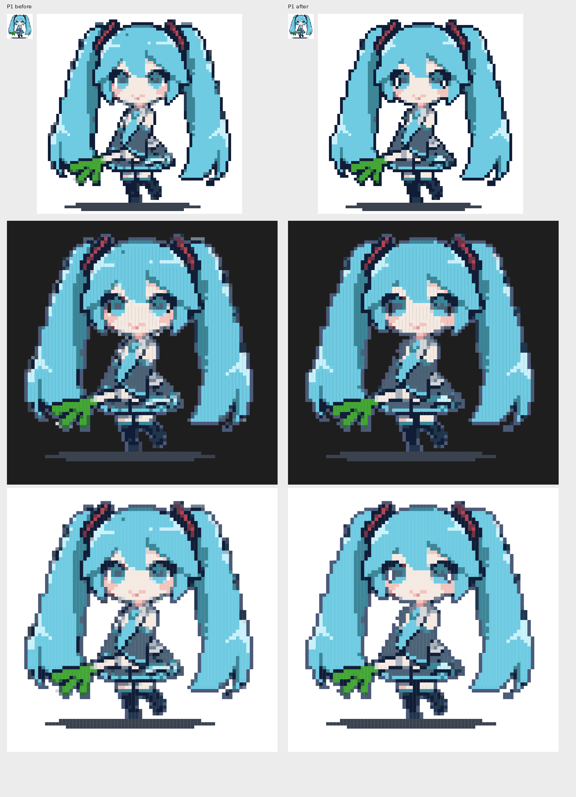

**P2's raised hand** (its own commit) is 2 px taller: a knuckle row with the stalk passing through it, and a palm row below. The wink, the kick and the leek angle are unchanged.

The first attempt was worse at 1×, so I dropped it. It put a fist where the stalk was, which read as a pale square.

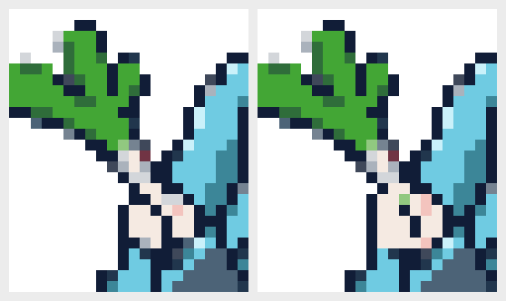

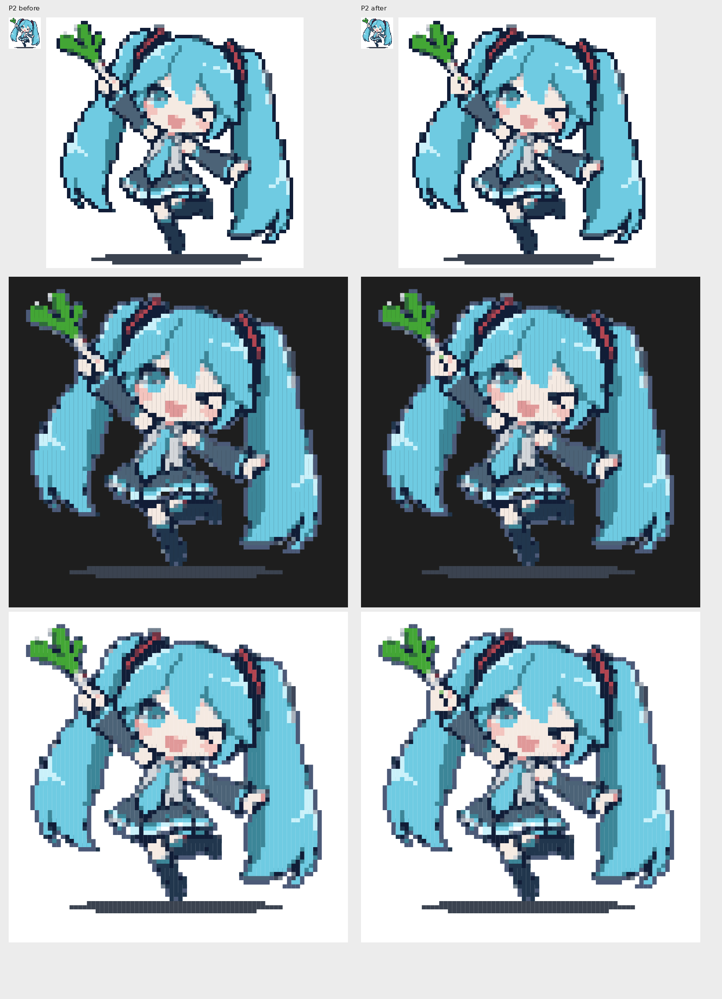

## 2. Turnaround

Front (P1), 3/4 right, side right, and the left-facing mirrors share one height line and baseline, beside the source sheet.
- **Face:** after mirroring it's still P1's eye in profile.
- **Leek:** it stays on the near shoulder in the mirrors too.
- **Tails:** in side view the far tail is behind the body and the near tail in front. Both are procedural chains, and every frame stores their points.

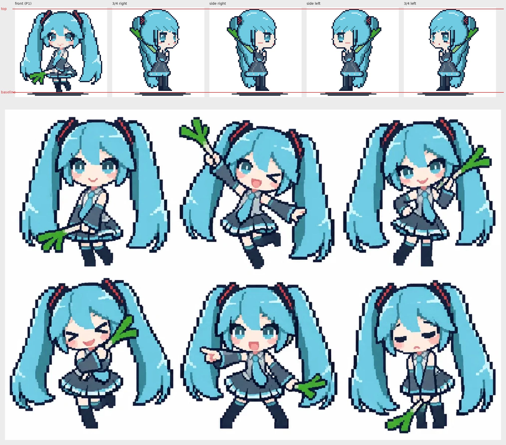

## 3. Thumbnails, with provisional picks (yours to choose)

**Side head and face**, four alternatives:
- **A (my provisional pick):** P1's round eye in profile. It keeps the likeness closest.
- **B:** an almond eye.
- **C:** P5's bright open eye.
- **D:** a longer fringe over the eye.

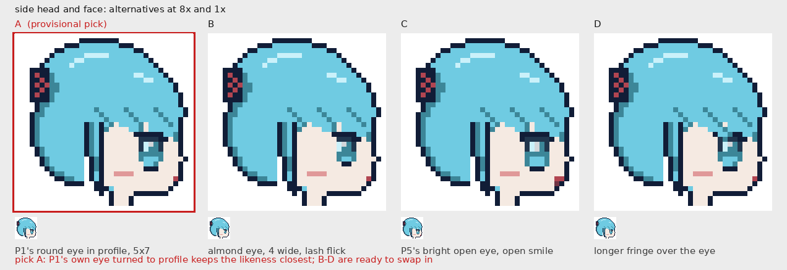

**Walk passing pose**, four alternatives:
- **D (my provisional pick):** a higher kick, a lean, a stronger skirt lag and the tails swinging out. It's the only one with a clear line of action.
- **A, B and C** differ only slightly from each other.

The in-betweens were developed for A and D only, and the others are ready to swap in.

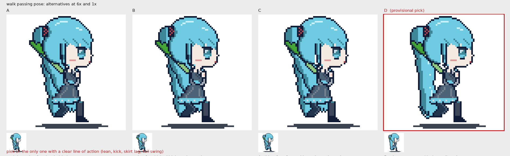

## 4. Clips

Every clip's exposure sheet was written before its frames (`tools/miku/xsheets/`), and the ticks in the data files match the sheets exactly (tested).

- **Walk:** 8 drawings (contact, down, passing and up for each leg), 12 ticks, one second per cycle.
  - Bob: 2 px on the down and up drawings.
  - Arms: the near arm keeps P3's shoulder carry, and the far arm swings against the legs in its shadow colours.
  - Lag: the skirt hem lags a tick and flares at the back, and the tails trail with phase-delayed swing and lag.
  - Head: it only bobs. This is tested on the face, fringe and front of the crown.

  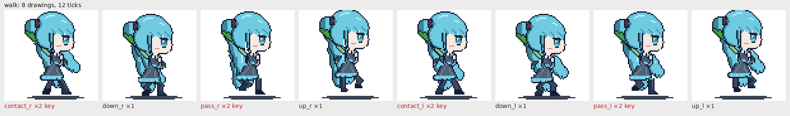

  

- **Walk tired:** the same eight drawings held longer, 20 ticks per cycle.
  - P6's sleepy face.
  - The head 2 px lower and forward, with the shoulders dropped.
  - A shorter stride.
  - The near arm hangs and drags the leek, its leaves on the ground.

  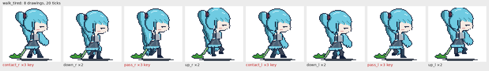

  

- **Turns:** `turn_to_side` and `turn_to_front` both run front → 3/4 → side over 6 ticks, with the tails swinging through. Left is the mirror.

  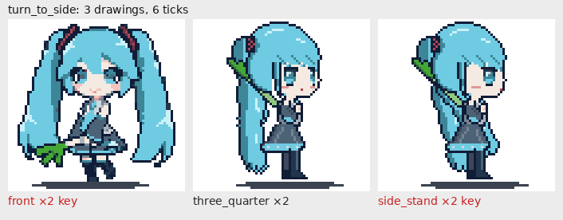

- **GIFs:**
  - `miku_v2/gate2/walk_both_ways.gif`: she turns, walks across a box top, turns to the front at the end, turns back and walks the other way.
  - `miku_v2/gate2/walk_tired.gif`

  The demos were recorded through a pseudo-terminal into asciicast v2 and rendered with agg 1.9.0 in DejaVu Sans Mono. asciinema itself is installed, but it deadlocks without an interactive terminal on stdin, so the repo's recorder captured the same cast format instead.

- **Terminal screenshots:** the passing frame on dark and light backgrounds, plus 3/4 and tired-walk frames, are the `terminal_*.png` files in `miku_v2/gate2/`.

**Facing rules.** These live in the runtime facing planner and are tested:
- she faces the way she moves
- every direction change plays a turn
- a reversal goes through the front view; she never jumps profile to profile and never moonwalks
- the walk cycle plays only in profile
- she turns to the front when she stops, and the turn after a stop ends facing the target.

The demos are driven by this planner. Putting v2 Miku onto the captured graph itself needs the bigger graph from section 5, which is a later gate.

## 5. Critic scores (fresh subagent each round; 1–5)

| Dimension | Round 1 | Round 2 | Round 3 |
|---|---|---|---|
| likeness / P1 consistency | 3 | 3 | 3 |
| silhouette | 2 | 2 | 3 |
| consistency across frames | 4 | 3 | 3 |
| pose readability | 3 | 2 | 3 |
| timing | 5 | 4 | 4 |
| pixel discipline | 3 | 3 | 3 |
| dark-terminal contrast | 4 | 3 | 4 |
| gesture | 2 | 2 | 2 |
| asymmetry and weight | 2 | 2 | 2 |
| taper and flow | 2 | 2 | 2 |
| appeal | 2 | 2 | 2 |
| **total (of 55)** | 32 | 28 | **34** |

The round 3 version is kept as the best so far. It did not reach the target of 4 on every dimension within the three allowed rounds.

- **Round 1 → 2:**
  - The tails became a split, flaring tip with a stepped back edge and lag that varies through the cycle.
  - The head and torso lean into the walk.
  - The skirt hem slopes and flares.
  - The tired walk slumps more.
  - The far arm swings.
  - The side lock steps and tapers.
  - The boots got a lighter shin edge.
- **Round 2 → 3:**
  - Two distinct tails, the near one crossing the back of the body.
  - A stride of 11 px instead of 5.
  - A 2 px bob.
  - Boots filled dark slate inside a navy edge.
  - A narrow far eye in the 3/4 face.
  - The far arm in its shadow colours.

**Still open after round 3:**
- **Tails in profile:** they still read as a column behind the back, not the signature flared mass.
- **No counter-rotation:** the spine stays fairly upright, with no hips-against-shoulders twist.
- **Legs:** they don't taper or bend much.
- **Front to 3/4 turn:** the leek jumps from P1's low grip to the shoulder carry.
- **3/4 body:** apart from the face, it's still close to the side view.
- **Profile face:** the front of it is a long straight line.

The round 3 critic also called the far leg's grey sock fill a palette error. It's the deliberate far-side shade, but it's a fair point that the style bible doesn't say so.

## 6. Honesty fixes (wording and metadata, two commits)

- **Fork caption:** "independent: neither waits for the other". No UI string says "parallel"; the only exception is the single-stream note you specified, and a test enforces this. The join caption is unchanged.
- **No time axis:** the pace is the same at every node; pauses depend only on node type and position. A test checks that every node is held the same number of ticks. That test caught the first node being held one tick less, and it was fixed. The README now says "The walk has no time axis: it shows structure, not timing."
- **Provenance header:** printed with every run. The stream count is measured during capture: it counts every CUDA stream that issued work (6 for decode). The rest:
  - **GPU name:** read from the runtime.
  - **CUDA version:** read from the runtime.
  - **cuBLAS version:** read from the loaded library.
  - **GEMM shapes:** recorded from the GEMM calls during capture.

  A one-stream capture adds the single-stream note. The node list is titled "kernel names: chosen at capture for these shapes on this GPU".
- **Naming:** "captured graph" in the header, the status line, the CLI description and the README.
- **Tests:** the header has the stream count; the single-stream note appears when there is one stream; no UI string says "parallel"; captions carry no timing words.

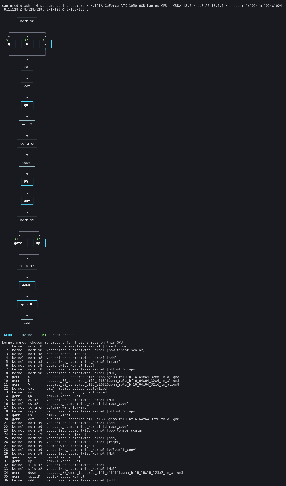

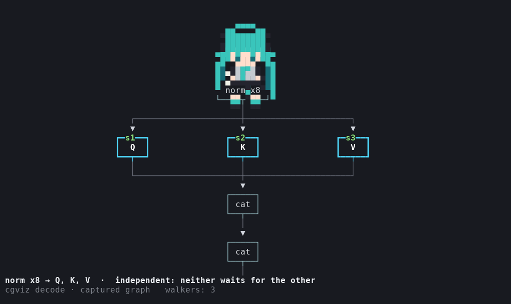

## Decisions for you

1. Pick the side face (A–D) and the passing pose (A–D).
2. **Tails in profile** are the biggest gap left. I can hand-draw a set of profile tail shapes as keys and let the procedural chain only animate between them, if you'd rather have hand-placed tails than a pure procedure.
3. **The leek during the turn:** keep the jump from P1's low grip to the shoulder carry, add an in-between where she lifts it, or carry it low in the walk too.
4. **Far-side shading:** the far leg and arm use the cloth shadow colours on purpose. Say whether that's acceptable, and I'll add it to the style bible either way.
