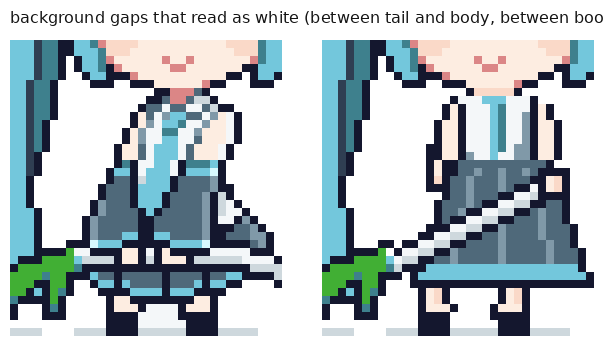
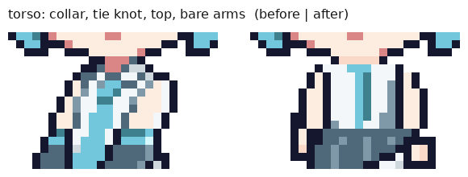
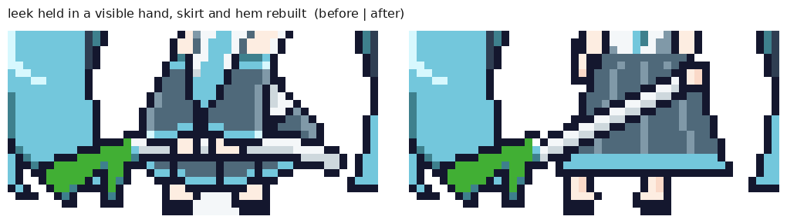
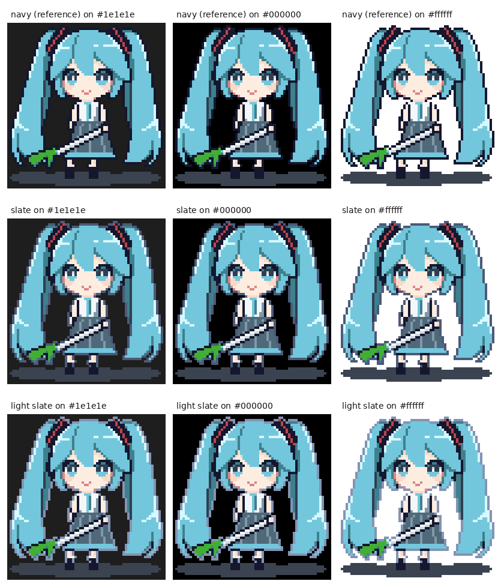

# Miku v2: the reference, extracted

The target design is `assets/reference/miku_ref.png`, an 860×860 image. This document records how its native pixel grid was recovered, the palette, every correction made to the reference's artefacts, and the resulting front idle frame. That frame is the ground truth for proportions and colours from here on.


## Recovering the grid

The reference is pixel art that was scaled up and softened: it contains 28,296 distinct colours and blurred block edges.

- **Pitch.** The study step measures how sharply colour changes between neighbouring image pixels, then fits a regular grid to where those changes cluster, trying non-integer pitches and phases. The best fit is a pitch of **8.96 image pixels per art pixel** on both axes (phase 7.75 horizontally, 8.0 vertically), giving a 95×95 grid over the whole image. The brief estimated about 8.6; the measured value fits the edges better.
- **Sampling.** Each cell takes the median colour of its central half, which ignores the blurred borders between blocks.
- **Palette.** Similar colours were merged until the materials stopped splitting further. A tight threshold keeps the skirt grey, the hair's dark teal shadow and the skin shade as separate colours, as the reference shows them. A loose one merges them. The result is 13 colours plus one recovered white.
- **Size.** Cropped to her body and ground shadow, the native front frame is **66 × 69 pixels** (66 wide, 69 tall). The body without the shadow is 62 pixels tall, which is **31 terminal rows** in half-block rendering.

The study outputs (zoom, swatch, silhouette, report) are in `findings/miku_v2/study/`.

## Palette

| Letter | Hex | Name |
|---|---|---|
| A | #73c7dc | hair cyan (base) |
| F | #d7f8fe | hair highlight |
| D | #3e808d | hair shadow teal |
| H | #2f3e52 | dark slate (iris, inner hair line) |
| B | #14172e | outline navy |
| L | #c04449 | hair-tie red |
| E | #fdede1 | skin |
| J | #fad9c8 | skin shade |
| M | #db8686 | blush and mouth pink |
| W | #f4f7f9 | top white (also eye white) |
| K | #8099a8 | grey-blue: top shading and skirt pleat lines |
| G | #4f697a | skirt grey |
| I | #41af34 | leek green |
| C | #ced8dd | pale grey: leek stalk, ground shadow on white |

Two colours are added for terminals only (see the contrast section): **O #4c5a78**, the outer silhouette outline, and **S #3b4350**, the ground shadow on a dark background.

## Corrections, with before and after

Following the reference in good faith meant keeping its design and fixing what is clearly an artefact of how it was made. Everything not listed here is exactly as extracted.

1. **Stray squares and bar.** Three cyan squares in the top-right corner and a cyan bar in the bottom-right aren't part of her. They were removed as detached pieces, along with any other piece smaller than 40 cells.

   

2. **White read as background.** The white top and the eye whites are the same white as the image background, so the first pass made them transparent. Any background-coloured pocket fully enclosed by her outline and smaller than 30 cells was restored as top white. The larger enclosed gaps, between the left tail and her body and between her boots, really are background and stay transparent.

   

3. **Torso.** In the reference, the white top and the tie area don't resolve into anything readable. They were redrawn as a skin neck, white collar points either side, a cyan tie knot with the tie running down to a point and its teal shadow side, a white top with grey-blue shading on her left side, and bare skin shoulders and arms down both sides (the outfit is sleeveless). The colours and the width of the torso are the reference's.

   

4. **Leek, skirt and hem.** In the reference, no hand holds the leek, and the stalk runs across the hem toward her right tail, tangled with the skirt trim and the legs. The changes:
   - **Leaves:** kept exactly.
   - **Stalk:** now a clean diagonal from the leaves up to her right hand, which grips it (skin with a shade), ending inside the hand well before the tail.
   - **Left hand:** rests at her side.
   - **Skirt:** rebuilt behind the stalk as the reference's flared dark-grey skirt, with three lighter pleat lines fanning out from the waist and the cyan trim band above the hem.
   - **Legs:** short skin legs onto the reference's own boots.

   

5. **Leftover pixel.** One outline pixel from the old stalk tip, right of the hem, was removed.

## Outline contrast on terminals

Navy is kept for every line inside the silhouette. For the outer silhouette edge only, three colours were tested on `#1e1e1e`, `#000000` and `#ffffff`:
- **Reference navy:** disappears on both dark backgrounds, leaving her tails with no edge.
- **Light slate:** reads on dark but looks washed out on white.
- **Mid slate (#4c5a78):** keeps the silhouette clear on dark backgrounds and still reads as the reference's dark outline on white. **Chosen.**

The ground shadow's pale grey is close to invisible on dark terminals. It becomes the dim **#3b4350**, which reads as a shadow on dark and is still a soft grey shape on white.



## In a real terminal

Rendered through the half-block renderer and the pyte screenshot tool, standing on a GEMM node, she is 31 rows tall plus 3 rows of shadow.


## The front idle frame (66 × 69)

One letter per pixel, `.` is transparent, letters as in the palette table. This is the frame before the terminal-only outer-outline and shadow colours are applied.

```text
..................................................................
......................BB....................BB....................
.................BBB.BBLBB....BBBBBBBB....BBLBB.BBBB..............
................BDDDBBLBBB.BBBAAAAAAAABBBBBBBLBBDDDDBB............
...............BAAABBBLBBBBAAAAAAAAAAAAAABBBBLBBBAAAADB...........
..............BAAADBBLBBBFAAADAAAAAAAAAAAAFBBBLBBDAAAAFB..........
.............BAAAABBLBBBFAAADAAAAAAAAAAAAAAFBBBLBBAAAAFB..........
.............BAAABBLBBBFAAAADAAAAAAAAAAAAAAAFBBLBBBAAAAFB.........
............BFAAABBLBBFAAAAADAAAAAAAAAAAAAAAFFBBLBBAAAAFB.........
............BFAABBLBBFFAAAADAAAAAAAAFFAAFFFFFFFBLBBBAAAAFB........
............BAAABLBBBFFFFFADAAAAAAAAAAAAAAAAAAFBBLBBAAAAFB........
...........BFAAABLBBFFAAAAADAAAAAAAAAAAAAAAAAAAFBLBBAAAAFB........
...........BFAAADBBBFAAAAAADAAAAAAAADAAAAAAAAAAABBLDAAAAAFB.......
...........BFAAADBBFAAAAAAADAAAAAAAADAAAAAAAAAAAABBDAAAAAFB.......
..........BFAAADDDBFAAAAAAADAAAAAAAADDAAAAAAAAAAABBDAAAAAFB.......
..........BFAAADDDBFAAAAAADJAAAAAAAAJDDAAAAAAAAAABBDDAAAAAB.......
..........BFAAADDBBAAAAAAADJAAAAAAAAJJJDAAAAAAAAAABDDAAAAAFB......
.........BFAAAADDBBAAAAAADJEJAAAAAAAEEJJDAAAAAAAAABDDAAAAAFB......
.........BFAAAADDBAAAAAADJEEEAAAAAAAEEEEJDAAAAAAAABDDAAAAAFB......
.........BFAAAADDBAAAAADBBBBEEAAAAAAEEBBBBBDAAAAAAABDAAAAAFB......
........BFAAAAADBBAAAADBBBDDBEEAAAAAEBBDDBBBDAAAAAABDAAAAAAB......
........BFAAAAADBBAAADDBBDHHHBEEAAAABDHHHHBBDDAAAAABDAAAAAAAB.....
........BFAAAAADBBAADDDBCHHCHEEEEEEEEHHCHHCBDDDAAAABDAAAAAAAB.....
........BAAAAAADBBABDADBWHHWHEEEEEEEEHHWHHWBDADDDAABDAAAAAAAB.....
.......BAAAAAAAHDBBBAADMWAAAAEEEEEEEEAAAAAWMDAAABBBBAAAAAAAAB.....
.......BAAAAAAAHDBBBAADMJJAAEEEEEEEEEEAAAJJMDAAABDDHAAAAAAAAB.....
.......BAAAAAAAHDDBBAADMJJJJEEEEEEEEEEEJJJJDAAABBDDHAAAAAAAAB.....
......BAAAAAAAAHDDBBAAADJJJEEEEEEEEEEEEEJJJDAAABBDDHAAAAAAAAAB....
......BAAAAAAAAHDDB.BAADMEEEEEEMEEMEEEEEEEMDAAB.BDDHAAAAAAAAAB....
......BAAAAAAAAHDDB.BAADBMEEEEEEMMEEEEEEEBBAAAB.BDDHAAAAAAAAAB....
......BAAAAAAAAHDDB..BAABBBMEEEEEEEEEEEBB.BAAB..BDDHAAAAAAAAAB....
.....BAAAAAAAAHDDB....BBB..BBBEEEEEEMBB...BBB...BDDHAAAAAAAAAB....
.....BAAAAAAAAHDDB............BJJJJJB...........BDDHAAAAAAAAAB....
.....BAAAAAAAAHDDB..........BWWWAAAWWWB.........BDDHAAAAAAAAAB....
....BFAAAAAAAAHDDB.........BEBWWWADWWWBEB.......BDDHAAAAAAAAAFB...
....BFAAAAAAAAHDDB.........BEBWWWADWWKBEB........BDHAAAAAAAAAFB...
....BFAAAAAAAAHDB.........BEEBWWWADWWKBEEB.......BDHAAAAAAAAAFB...
...BFAAAAAAAAAHDB.........BEEBWWWADWWKBEEB.......BDHAAAAAAAAAFB...
...BFAAAAAAAAAHDB.........BEEBWWWADWWKBEEB.......BDHAAAAAAAAAFB...
...BFAAAAAAAAAHDB........BBEEBWWWADWKKBEEB.......BDHAAAAAAAAAFB...
..BFFAAAAAAAAAHB.........BBEEBKWWAWWKKBEEB.......BDHAAAAAAAAAFFB..
..BFFAAAAAAAAAHB.........BEBBGGGGGGGGGGGB.........BHAAAAAAAAFFFB..
..BFFFAAAAAAAAHB.........BEBBGGKGGKGGKGBBBB.......BHAAAAAAAFFFFB..
..BFAFFAAAAAAAB..........BJBGGKGGGKGGGBBEJB.......BHAAAAAAFFAAFB..
.BFAAAAFFAAAAAB..........BBBGGKGGGKGBBWBEJB........BAAAAFFAAAAFB..
.BFAAAAAAAAAAAB............BGGKGGGBBWWCBBBB........BAAAAAAAAAAAFB.
.BFADAAAAAAAAAB...........BGGGKGBBWWCCBBGGB........BAAAAAAAAAAAFB.
.BFADAAAAAAAAAAB..........BGGKBBWWCCBBGKGGB........BAAAAAAAAAAAFB.
.BAADAAAAAAAAAAB..........BGBBWWCCBBGGGKGGB........BAAAAAAAAAAAAB.
.BAADAAAAAAAAAAB.........BBBWWCCBBKGGGGKGGGB......BAAAAAAAAADAAAB.
.BAADAAAAAAAAAAB........BBWWCCBBGGKGGGGKGGGB......BAAAAAAAAADAAAB.
.BAADAAAAAAAAAAB...BB.BBWWCCBBGGGGKGGGGGKGGB......BAAAAAAAAADAAAB.
.BAABAAAAAAAAAABBBBI.BWWCCBBKGGGGGKGGGGGKGGGB.....BAAAAAAAAADAAB..
.BAABDAAAAAAABBBIIIIAWCCBBGGKGGGGGKGGGGGKGGGB.....BAAAAAAAADBAAB..
..BAABDAAABBBIIIIIIIDCBBBAAAAAAAAAAAAAAAAAAAB....BAAAAAAAAADBAAB..
..BAABBDBBIIIIIIDIIBBB.BAAAAAAAAAAAAAAAAAAAAAB...BAAAAAAAADBBAB...
...BAB.BBIIIIIIBBIIB...BBBBBBBBBBBBBBBBBBBBBBB...BAAAAAAADB.BAB...
...BAB..BIIIIIBABIDB....BEJB......BEJB..........BAAAAAAABB.BAB....
....BAB..BIIDBBBBIB.....BEJB......BEJB..........BBBBBBBB..BAB.....
.....BBB..BDB...BDB.....BEEEB....BEEEB...................BBB......
...........BB...BBB.....BBBB.....BBBBB............................
........................BBBB......BBBB............................
.....CCCCCCCCCCC....CCCCBBBBCCCCCCBBBBCCCCC.....CCCCCCCCCCCC......
..CCCCCCCCCCCCCCCCCCCCCCBBBBCCCCCCBBBBCCCCCCCCCCCCCCCCCCCCCCCCC...
.CCCCCCCCCCCCCCCCCCCCCCCBBBBCCCCCCBBBBCCCCCCCCCCCCCCCCCCCCCCCCCC..
..CCCCCCCCCCCCCCCCCCCCCCCCCCCCCCCCCCCCCCCCCCCCCCCCCCCCCCCCCCCCC...
.....CCCCCCCCCCCCCCCCCCCCCCCCCCCCCCCCCCCCCCCCCCCCCCCCCCCCCCC......
....................CCCCCCCCCCCCCCCCCCCCCCC.......................
..................................................................
```
