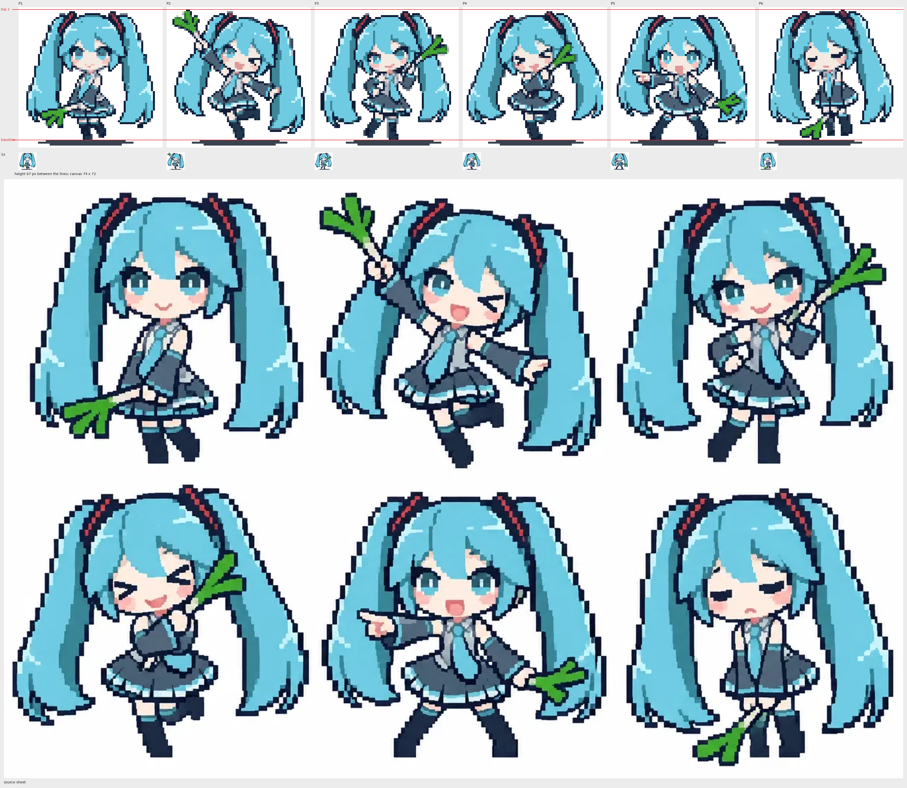
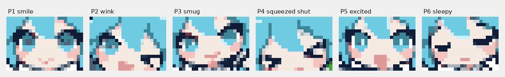
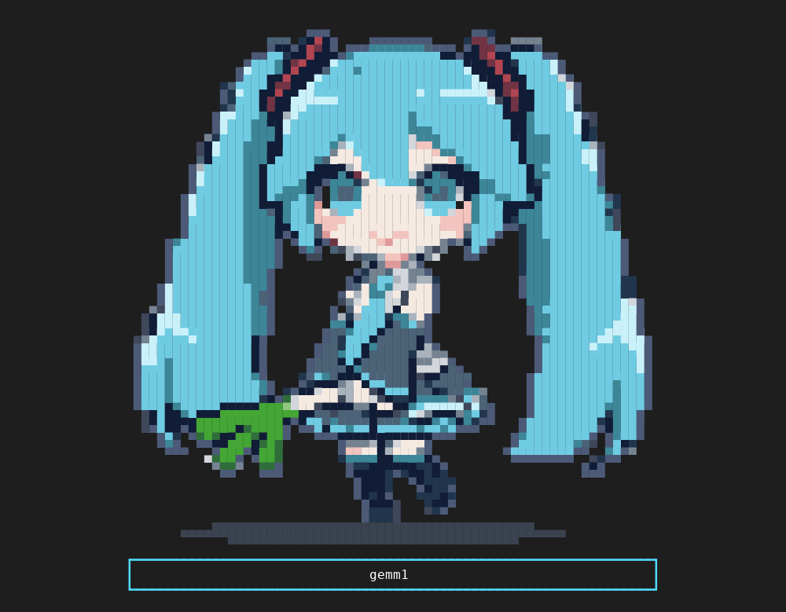
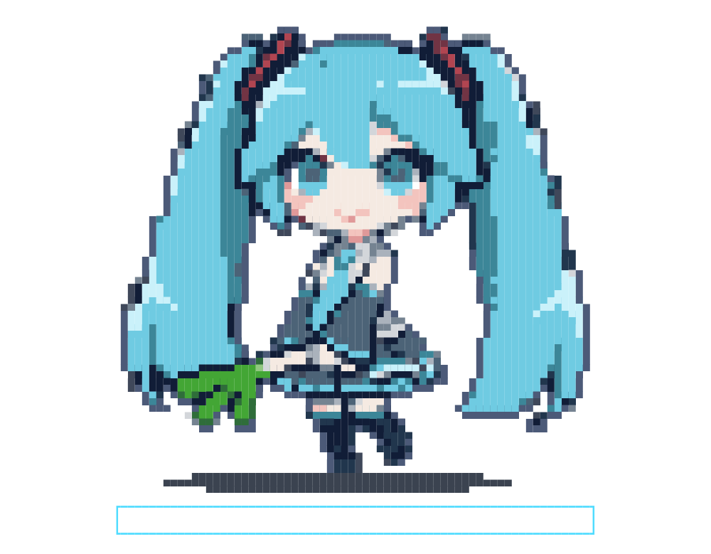

# Miku v2: the reference model

The first GATE 1 was rejected (Addendum 1). Its torso, tie, arms, hands, skirt and leek were built from rectangles and came out stiff. What carries over from it:
- the grid-extraction method
- the slate outer outline over navy inner lines
- the dim ground shadow
- the stray-pixel cleanup
- the palette naming.

The design authority is now the six-pose sheet, `assets/reference/miku_poses.png`. The first reference, `miku_ref.png`, is only a fallback for anything the sheet doesn't show.

## Extraction

**The sheet has no reliable native grid.** It's 1344×896. Fitting a grid to its colour edges finds a strongest pitch of about 8.95 image pixels, the same as the first reference. But that fit is weak: edge energy on the grid lines is only 1.5–1.6× the average, against 5.3× for the first reference. The sheet also carries detail finer than that pitch, especially in the faces. Sampled on the 8.95 grid, the poses come out 46×45 pixels and the faces are destroyed.

**So each pose is sampled straight from the high-resolution sheet at the normalisation scale.** The pitch is 6.17 image pixels, chosen so the six poses come out at the same height as the GATE 1 measurement. Each cell takes the median colour of its central half. The result is six poses of 65–70 by 65–67 pixels, all at the same pixel scale, with faces, hands and the tie readable.

**Normalising to one character:**
- **Height:** every pose is 67 pixels from the top of her head to the soles of her boots.
- **Baseline:** all six boot soles sit on the same row, row 67 of a shared 74×72 canvas. A dim ground shadow is added under the feet.
- **Palette:** one shared palette (below) for all six.
- **Head and eyes:** no edits were needed to the head construction or eye shape. The six faces already match each other once they're on the same scale and palette.
- **Sock bands, cuffs and hair ties** come out consistent across the poses at this scale, so no pose needed P1's version substituted.

## Palette

One palette for all six poses, in ramps of two or three steps per material.

| Letter | Hex | Name |
|---|---|---|
| G | #caf1fa | hair highlight |
| A | #6fcbe2 | hair cyan |
| C | #3c8698 | hair shadow teal |
| B | #111d37 | outline navy |
| F | #21364d | dark slate: socks, boots, iris |
| L | #d3d6da | top light grey |
| N | #aab2bc | top grey |
| K | #758391 | top shade, pleat line |
| D | #4c6377 | skirt and sleeve grey |
| M | #3f485a | skirt and sleeve shadow |
| E | #f5eae2 | skin |
| P | #f3c4be | skin shade |
| U | #e09999 | blush |
| S | #b14551 | hair-tie red, mouth |
| V | #713444 | mouth inside, hair-tie stripe shading |
| b | #91c880 | leek stalk, pale green |
| I | #43a635 | leek green |
| X | #2f6d3a | leek shadow green |
| O | #4c5a78 | outer outline slate (terminal) |
| Z | #3b4350 | ground shadow (terminal) |

The 28 colours sampled from the sheet map onto these 18 body colours. Near-duplicates produced by compression and anti-aliasing merge into the material they belong to. The two terminal colours are carried over from the first GATE 1.

## Corrections

Every correction is an edit to the extracted pixels; nothing was rebuilt. Each pose has a before/after view showing the raw resample, the pixels that changed (in red) and the cleaned result. The changes are scattered single pixels along edges. The pose, gesture, cloth flow and hands are untouched.

1. **Anti-alias halo removed** (47–89 pixels per pose). A light pixel on her outer edge, sitting outside the navy outline, is a blend of outline and white background. Pixels on the very edge of each pose's crop count as edge too.
2. **Outline restored or tidied** (6–14 pixels per pose). Where the navy outline had faded to grey between the background and hair, it is navy again. A grey pixel outside the outline whose only neighbours are outline is removed.
3. **Specks** (2–10 pixels per pose). A single off-material pixel surrounded on three or four sides by one hair or outline colour takes that colour. Hair-tie red and its stripe shading are never treated as specks.
4. **Stray mouth colour** (1–5 pixels per pose). Mouth and blush colours found away from the face and away from the hair ties take the colour around them. An early version of this rule also caught the hair-tie stripes' dark half and erased the stripes. That was caught in review and fixed: the stripes are intact.
5. **Islands:** none needed removing.

| Pose | Before / changed / after |
|---|---|
| P1 |  |
| P2 |  |
| P3 |  |
| P4 |  |
| P5 |  |
| P6 |  |

Nothing was straightened, symmetrised or redrawn. Any anatomy defects left over (for example a hand that reads poorly at this size) are for your call at this gate.

## Face library

The six faces, taken straight from the poses: smile (P1), wink (P2), smug (P3), squeezed shut (P4), excited with mouth open (P5), and sleepy (P6). Surprised, panting and blink will be derived from these at the clip stage, as Addendum 1 specifies.

## P1 in a real terminal

P1, the master front frame, standing on a node. Rendered through the half-block renderer and the pyte screenshot tool with the slate outer outline, it is 34 rows tall.

## Stiffness flags

These are warnings for the critic, not failures:
- **Torso mirror similarity:** 0.40–0.55 for every pose, well under the 0.85 threshold.
- **Straight outline runs longer than 5 pixels on limbs or clothing:**
  - P1: one vertical run (6 pixels at the skirt's right edge)
  - P5: one horizontal run (8 pixels along the pointing arm)
  - P6: two vertical runs (her straight standing leg and the dropped arm, which suit a sleepy pose)
  - P2, P3 and P4: none.
