# Miku v2: size tiers (compact Miku for an 80x24 terminal)

This gate builds on commits f22d1a8 (terminal support) through 802192c (critic round 3 fixes). The goal: anyone can watch in the terminal they already have, with no need to make it bigger first.

## 1. Cheap wins (terminal support)

| Change | What it does |
|---|---|
| Colour depth detection | Truecolor where the terminal says it supports it (`COLORTERM`, Windows Terminal, iTerm, kitty, ghostty, `*-direct`); otherwise the nearest xterm-256 colour. `CGVIZ_COLOR` overrides the guess. Every pair of Miku palette colours stays distinct in 256 colours (tested). |
| Synchronized output | Each frame is wrapped in DEC mode 2026, so terminals that support it draw the frame all at once instead of tearing. Terminals that don't support it ignore it. |
| Windows VT mode | On Windows, VT processing is turned on for the console. If it can't be turned on, the animation is skipped and you get the static view instead of escape-code garbage. |
| Tier pick | The largest Miku that fits the terminal, keeping 6 rows and 16 columns for the graph and the caption. If even the compact Miku doesn't fit, you get no sprite. |

| Tier | Sprite | Terminal it needs |
|---|---|---|
| full | 74x72 px (36 rows) | 90x42 or larger |
| compact | 37x36 px (18 rows) | 53x24 or larger, which includes the default 80x24 |

## 2. Why not thumbnail B

Thumbnail B was redrawn from scratch at small size. It was rejected: it didn't look like the approved Miku. The compact tier is now **the approved drawings halved**, then cleaned up by hand.

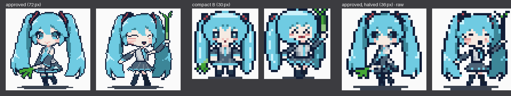

## 3. How the compact tier is made

1. **Even offsets.** The approved pose is rebuilt with the bob, head shift and head offset rounded to even pixels, so every frame halves on the same pixel pairs and the face doesn't shimmer from frame to frame. A test checks this: once the bob is undone, the top of the head is identical in every walk frame.
2. **Thin parts left out before halving.** The leek, the arms and the torso don't survive halving, so they are drawn by hand at half size instead.
3. **Halving by vote.** Each 2x2 block becomes the colour that wins it. Leek pixels win first, then the outline, then accents. Lone specks are removed afterwards, and gaps in the outline are closed.
4. **Hand patches.** Eyes ('^' cheerful, half-lidded and line for tired), 2 px mouths, and the half-size torso, arms, raised, mid, low and dragged leek, and the front view. They get a navy ring, but never over skin and never below the feet.
5. **Same exposure sheets.** Every clip uses the same drawings and tick counts as the full tier, so the facing planner needs no change. A test checks this for all 8 clips.

## 4. Contact sheets

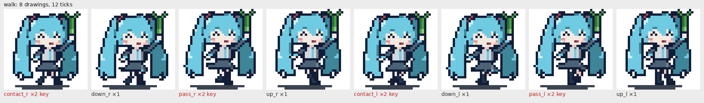
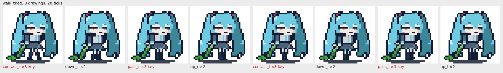
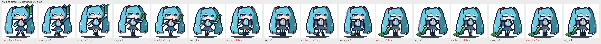
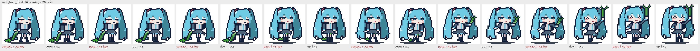
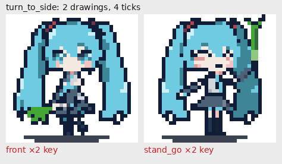
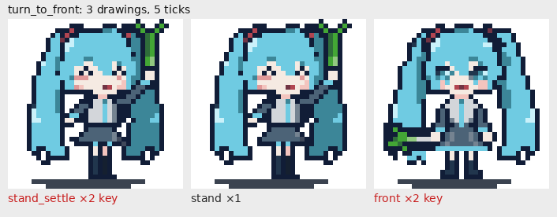
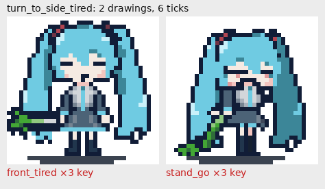
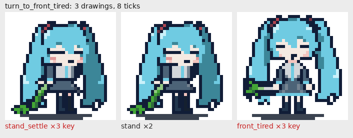

## 5. In an 80x24 terminal

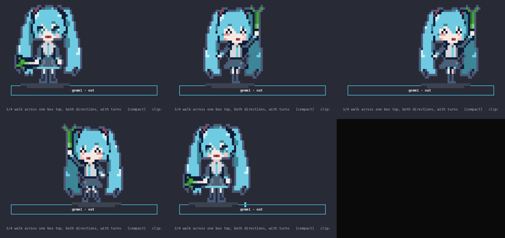
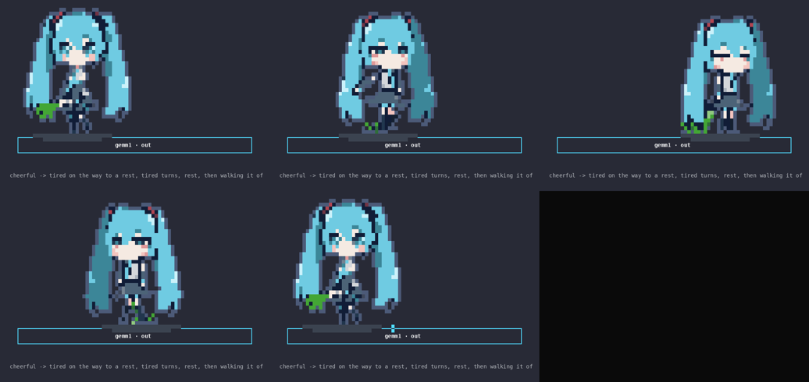

GIFs: [walk](miku_v2/tiers/compact_walk_80x24.gif), [rest](miku_v2/tiers/compact_rest_80x24.gif).

A note on the recordings: the first takes came out in 256 colours because the recording pty didn't set `COLORTERM`. The final takes are truecolor. The 256-colour takes are still a fair preview of what a 256-colour terminal shows.

## 6. Critic rounds

Each round, a fresh reviewer scored the compact tier against the approved sprite on the 11-dimension rubric (cheerful / tired).

| Round | Likeness | Contrast | Pixel discipline | Face | Leek | Total |
|---|---|---|---|---|---|---|
| 1: halved, plus eyes | 3 / 2.5 | 3 / 2.5 | 2.5 / 2 | – | 2 / 1.5 | 34.5 / 30.5 |
| 2: flat shirt, no bib, '^' eyes | 3 / 2 | 2 / 2 | 2 / 2 | – | 4 / 3 | 31 / 29 |
| 3: lash removed, leek lit edge, leek in front | 2 / 3 | 4 / 4 | 3 / 3 | – | 2 / 3 | 35 / 34 |
| 4: the round 3 fixes | 3 / 3 | 3 / 3 | 3 / 3 | 2 / 3 | 4 / 4 | **35 / 35** |

The round 4 version scores at least as high as round 3 on both moods, so it is kept as the best version so far.

## 7. Still open (from round 4, not fixed)

1. **Cheerful face.** At 1x the '^' eyes still read as open eyes, and the 2 px mouth reads as a surprised "o". A cleaner 3 px '^' with no dark pixel under it, plus a flat 1 px smile, should fix it.
2. **Tired face.** The blush sits right under the lids and reads as red eyes. It should move 1 row down and 1 px out. Two cyan stripes on the tired torso read as suspenders instead of one tie.
3. **Stride.** The legs are stubs that barely change between drawings, so it reads as a shuffle. Contact needs a wider spread; pass needs a lifted foot.
4. **Twintail taper.** The tails are rectangles with square tips. They should narrow in steps and end in points.
5. **Dark backgrounds.** Navy socks, the skirt and the shadow bar sink into dark backgrounds. A spur pixel on the down drawings flickers.
6. Smaller issues: the turn to front pops (there is no 45° drawing for the leek), and the horizontal front-view leek reads like a sword.
