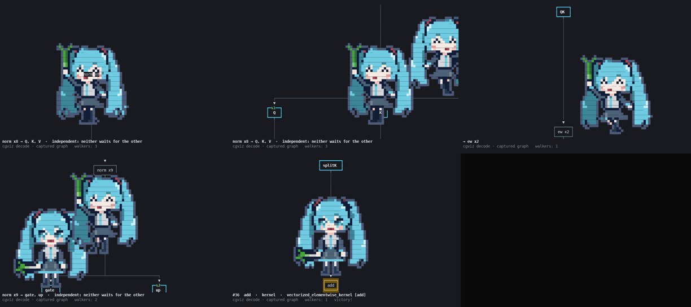
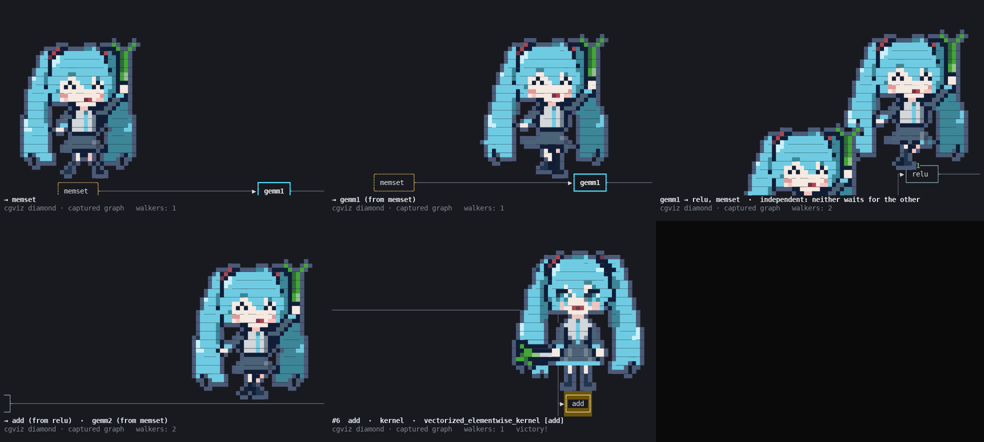

# Miku v2 walks the captured graph

`cgviz decode`, `cgviz prefill`, `cgviz diamond` and `cgviz draw path.py:function` now animate the v2 Miku over the real captured CUDA graph. She is sized to the terminal, and `--speed` sets the pace.

GIFs, recorded from real GPU captures: [decode, 100x30](miku_v2/walk_v2/decode_100x30.gif), [diamond, 80x24](miku_v2/walk_v2/diamond_80x24.gif). Both at `--speed 1.5`.

## Size

| Terminal | Sprite |
|---|---|
| 90x42 or larger | full (74x72 px) |
| 53x24 or larger, including the default 80x24 | compact (37x36 px) |
| smaller | the small v1 sprite, with its portrait panel |

`--miku-size auto|full|compact|small` overrides the choice.

## Facing rules on the graph

The rules from the facing planner now hold on the graph walk too. Tests check them on all three fixture graphs, at three sizes and speeds.

- She moves only in the walk cycle. She never moonwalks, and never walks in front view.
- Leaving a node, she turns from the front to her side before her first step.
- Before reversing direction, she turns through the front, standing still.
- At a node she turns to the front and stands while the box is highlighted.
- Waiting at a join, or holding at a fork, she stands in profile.
- The walk cycle advances one tick per cell walked. At any `--speed` her feet keep pace with the ground.
- The victory is the front pose with a hop, on top of the last box.

## Making room for her

The v1 sprite was 12 cells wide. The compact v2 is 37x20 cells, so the map and her placement scale with the sprite:

- **Spacing.** Siblings sit a sprite width apart, and consecutive layers a sprite height apart.
- **Edge tracks.** The horizontal fork and join tracks sit next to the target boxes, so she has open space behind her instead of the source box.
- **On a box's border.** On a box's right side she stands just right of it. On its bottom border she stands just under it. Either way she never covers its label.
- **Slide speed.** Her offset slides between these placements at a speed scaled to her size.
- **Camera.** The map is now larger than the terminal, and the camera follows her. When several walkers don't fit, it follows the leftmost.

The v1 path is unchanged: its keyframe goldens pass.

## Still open

- As she settles beside or under a box, her body can pass over its label for a few frames.
- When walkers at a fork don't all fit on screen, the ones the camera isn't following get cut off at the edge.
- Graphs are long walks at this size: decode takes about 70 s at `--speed 1.5`.
